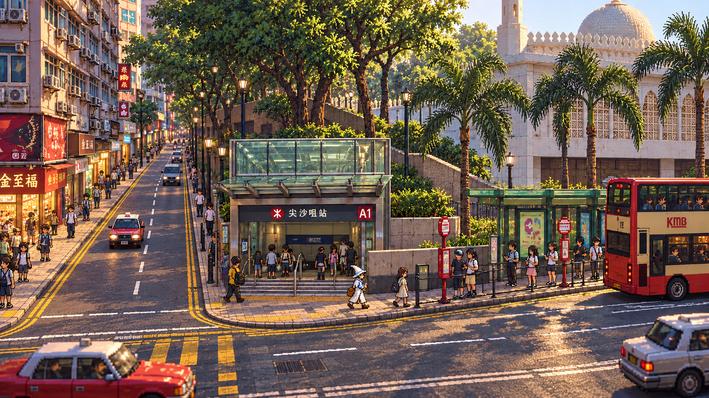
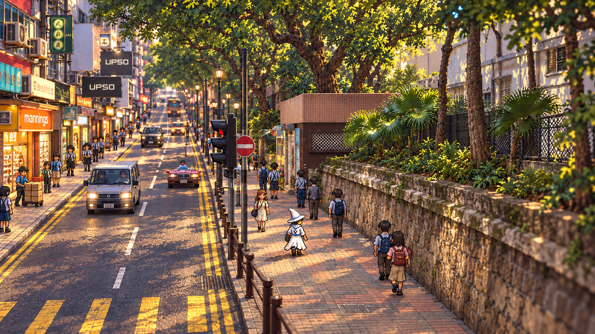

# 香港像素漫游

香港 HD-2D 像素步行开放世界：像素角色＋立体街景＋街道生活。当前有广东道约 30 米精修切片、白帽主角、有限公交／搬运活动和午后烘焙；仍是 v0.1 制作中的局部样板，完整街区美术、活动、声景与存档尚未验收。现状见 [资产与工序盘点](docs/08-blocks/tst-canton-demo/scene-inventory.md)。

最新交通精修：[九巴站牌、H2 观光巴士与三色的士](docs/08-blocks/tst-canton-demo/transport-v1.md)。广东道只投放红的士，已有独立 Player 往返与两分钟驻足验证。

## 最有价值的积累：越执行越成熟的工作流

**工作流建设是本工程第一优先级，也是这种 Agent 协作项目最有价值的长期资产。** 目标是把一次街角制作的经验，变成下一个街区可复用、可验证、能吸收反馈的方法。每次需求先选流程，每次改进反馈都回到流程的具体步骤，修订后通过实际产物复验。

- [workflows：动词](workflows/README.md)——街区总流程、HD-2D 子流程、角色／建筑／景物制作、场景装配与验证、反馈闭环。
- [docs：名词](docs/README.md)——事实与研究、策划、清单、已执行证据，为工作流提供可靠输入。
- [AGENTS.md](AGENTS.md)——唯一根入口，规定工作流选择、执行、反馈修订及每批提交推送。

资产目录齐全只是一个阶段：景物还要被正确摆放，与通行、人车活动、声景、镜头、光照和实机验证组合成完整体验。

## 街区概念图

以下为首街区的 HD-2D 风格探索，**不是实机画面，也不是已验收的游戏资产**。

### 弥敦道 × 海防道：白天主街

### 海防道：纵深街景

基于 Qwer132477、LN9267 的实景照片与 OSM 地图引导进行 AI 风格转译；可许可的改编图像按 CC BY-SA 4.0 提供。原始来源、署名与许可见 [参考索引](references/blocks/tst-nathan-haiphong/index.json) 和 [资产清单](assets/blocks/tst-nathan-haiphong/generated/concepts/manifest.json)，图中偏差见 [概念检查记录](docs/08-blocks/tst-nathan-haiphong/assets.md)。

## 项目导航

- [首批实施结果与操作说明](docs/08-blocks/tst-nathan-haiphong/implementation.md)：场景、资产、镜头参数和验证边界。
- [Unity 开发工程](unity/README.md)／[本地环境验证](docs/04-engineering/local-development.md)：锁定版本、插件、操作方法与实际验证边界。
- [研究总目录](docs/README.md)：八个主题的 Markdown 源文档与独立图文页。
- [从项目总纲开始阅读图文版](docs/01-vision/index.html)：通过章节导航阅读，不再拼接全部研究成长页。
- [远期 Roadmap](docs/06-production/roadmap.md)／[首个可玩版本 v0.1 实施规划](docs/06-production/v0.1-implementation.md)：版本范围、任务依赖与验收门槛。
- [Codex 阅读约定](docs/Agent.md)／[按任务读取研究](docs/Skill.md)。
- [街区还原工作流](workflows/00-project/街区还原工作流.md)：数据骨架 → 实景参考 → HD-2D 图生图 → 资产／建模 → Unity 街道生活 → 主角动线验证。
- [资产目录与指引](assets/Readme.md)／[数据目录与指引](data/Readme.md)：现有内容、来源、操作规则与待建结构。
- [香港选区资料包](data/hong-kong/README.md)：只读复用相邻 game-research 的公开资料快照，源数据与设计分别保存。

五张早期概念图和首街区三张新参考图均为探索图，不是实机画面。新旧概念与偏差归入 [空间与美术](docs/03-hd2d/README.md)；技术选择与兼容性归入 [引擎与运行架构](docs/04-engineering/README.md)。

复现文档：`../game-research/.venv-hk-data/bin/python scripts/build_report.py`。结构／引用检查：`python3 scripts/validate_docs.py`。数据提取与完整检查命令见资料包 README，历史结果及本次迁移记录见 [验证与证据](docs/07-validation/README.md)。

每个完成并验证的项目修改批次都生成 commit 并推送；目标远程及提交规则见根目录 [AGENTS.md](AGENTS.md)。

首个建议街区：[弥敦道 × 海防道／A1 选段与扩展计划](docs/08-blocks/tst-nathan-haiphong/plan.md) · [三张 HD-2D 渲染参考](docs/08-blocks/tst-nathan-haiphong/assets.md)。

当前精修入口：[广东道 30 米小场景与烘焙](docs/08-blocks/tst-canton-demo/polish-v1.md)。本机运行 `.local/builds/HongKong-Canton-Polish.app`；原广东道实时 demo 和弥敦道小样保留。
