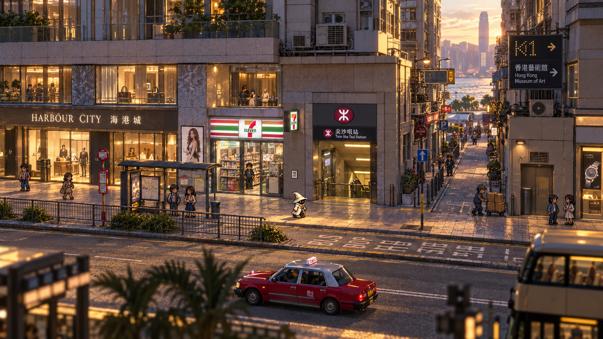

# HD-2D 美术规范与新概念

研究基线：2026-11-01 / v0.4。按主题整理；建议与待验证项不等同于已实现功能。

## 新概念图与美术规范

本图由内置 imagegen 生成，用于比较低视角、连续立面、纵深支路、白帽角色和前景虚化。**海港城、港铁口与便利店的相邻关系是构图编排；坡度、标牌和海面视线未核实。背景材质偏平滑写实，尚未达到正式环境应有的像素纹理统一度。** 它不作为地图施工图、深度图或可直接使用的背景。[完整提示词](../../assets/concepts/hd2d/prompt.txt)、[文件哈希及限制](../../assets/concepts/hd2d/manifest.json)

[旧四张概念图](concept-gallery.md)保留为角色、色彩与内容研究；旧戏曲中心图不再作为默认日常镜头。正式资产分别制作角色、楼体、路面、灯光和前景，不能把整幅生成图切几层就宣称具备正确透视与隐藏几何。

建议先比较以下参数，均为美术实验输入而非实机结论：

- 镜头：向下俯角约 25–35°，较远相机配合较窄视野的弱透视，与正交方案各做一版。最终角度以脚底可读、街道纵深及双侧铺面可见性决定；不能只凭单帧漂亮定案。
- 角色：以含帽 48–64 个源像素高为起点，测试四方向和八方向；屏幕尺寸由相机与角色世界高度共同决定。镜头转向时，动画方向按“相对相机的运动方向”选择。
- 环境：模块化低面数体积＋有明确像素颗粒的贴图；重点街面与角色统一视觉密度。材质导入先比较 point 采样与远景 mip 策略，检查斜面闪烁，不能以全局禁用 mip 作为万能规则。
- 分辨率：以 1080p 输出做首轮比较，并检查 720p／1440p 和窗口缩放。取消全屏固定 640×360＋整数放大的硬约束；像素贴图不要求整个三维画面都变为同样低分辨率，UI 单独保持清楚。
- 标识：繁体中文、英文、路线号、出口号独立排版。关键文字可以比背景纹理更高分辨率；像素风不应让站名、店名成为伪字。真实招牌是核实后的资产，不复制生成图乱码。
- 楼体：首层立面、转角、屋檐与雨篷有体积；上部楼层按轮廓压缩或在画外延伸。背街与高层远景可以简化，但镜头会看到的侧面必须存在。

## 补充生产约束

- 楼体提供转角、侧面、雨篷和真实深度；高层按轮廓压缩或裁出镜头。店铺立面、屋顶、橱窗、招牌、灯具可分拆，支持近景遮挡处理。
- 地面、米灰墙体、蓝绿玻璃和深绿树叶作为主色，商业与交通标识负责强调；不靠全城霓虹营造香港。白帽受暖光／冷光变化，但保持清晰轮廓。
- 繁体中文、英文、出口编号和路线板单独排字；关键文字优先可辨认。生成图中的伪字和店铺邻接关系不能直接沿用。
