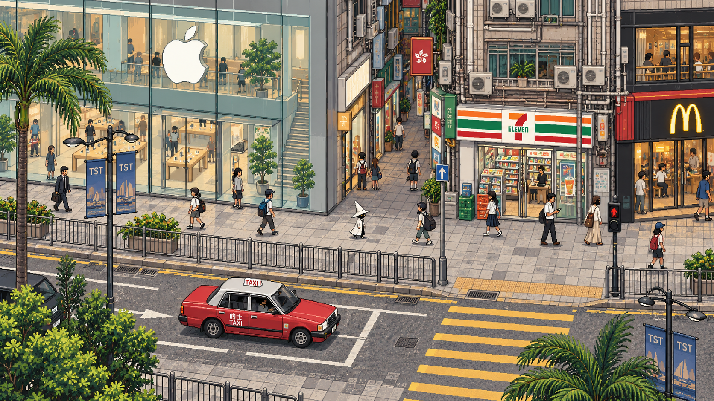
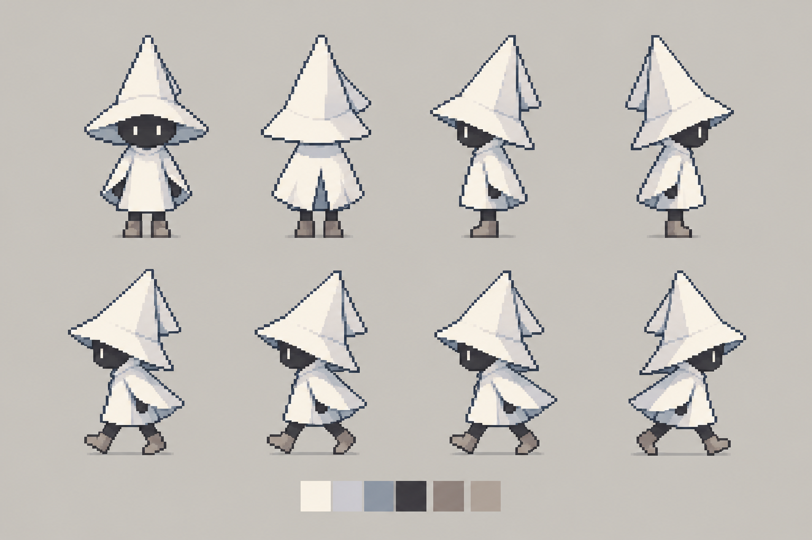
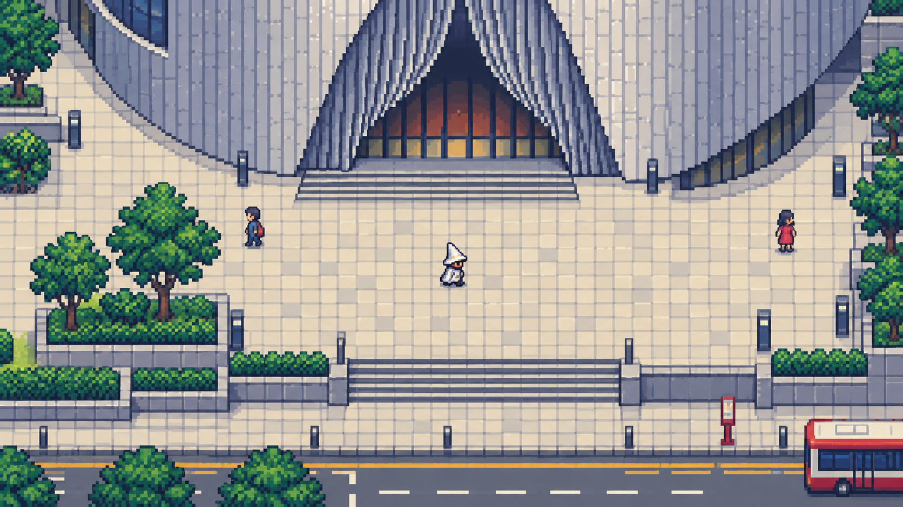

# 旧版概念图档案

研究基线：2026-11-01 / v0.4。按主题整理；建议与待验证项不等同于已实现功能。

## 概念图如何使用：新方向与历史研究

新的 HD-2D 构图与灯光研究已加入 [HD-2D 美术与新概念](art-direction.md)。以下旧四图保留为色彩、内容和角色探索，不再以其俯视镜头作为默认空间规范。

### A. 广东道商业街：店面与生活密度

保留玻璃旗舰店、窄铺、树木、栏杆、的士和小巫师之间的比例关系。**这是一幅组合街景，Apple、7-Eleven、麦当劳的相邻关系未经核实。** 图中细节密度与透视尚未按新 HD-2D 规格统一；用作颜色、气氛与店面表达参考，不用作整张游戏背景。

### B. 维港观景：对岸与停留

作为特殊观景画面的情绪目标。中银大厦在水面另一侧，画面提供远近层次。楼群的精确顺序、太阳方位和比例尚未按实景视线校正；不能从这张图反推地图。日常 HD-2D 镜头是否能见到此地平线，仍取决于实际位置、遮挡和俯角。

### C. 白帽小巫师：轮廓与动作

保留你指定的艾达式安静感、三角白帽、白衣轮廓，并采用短披肩与深色小面部。图中四向和走路是造型研究；角色比例、足底锚点、帧间体积、轮廓一致性和透明背景仍需重新制作，不能直接裁切成合格动画。

### D. 戏曲中心：旧版俯视镜头研究

这是旧版俯视方案的空间密度研究：建筑上部裁切、地面清楚、主角小而可辨。曲面立面、台阶和前场均为概念化处理，需用实际开放空间资料复核；仍不是严格 16×16 网格或实机截图。新方案只继承其中的街道可读性与店面识别度；镜头由新的 HD-2D 样板决定。

上述四图均由内置 imagegen 生成；最终提示词和文件清单保存在 `assets/concepts/prompts.json` 与 `assets/concepts/manifest.json`。原图没有被缩图或脚本重绘来冒充像素资产。风格是否符合预期仍需你的主观选择。

前两张为历史探索：第一张提示词混入纯 2D 俯视约束，第二张是观景构图。当前生产请以 [视角对照研究](octopath2-composition-study.md) 和实机镜头为准，保留旧图哈希。
