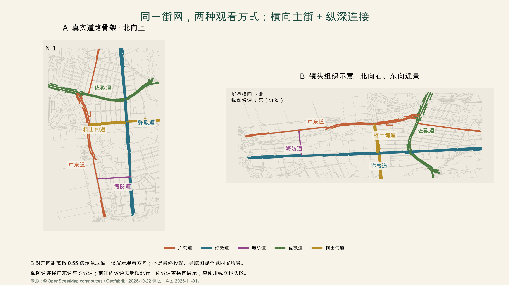

# 街网、尺度与镜头区

研究基线：2026-11-01 / v0.4。按主题整理；建议与待验证项不等同于已实现功能。

## 世界空间：横向主街与纵深连接

源数据保持真实坐标，游戏布局另存；保留主要路口顺序、海陆方向、地标街侧、车站身份和跨层关系。**横向描述的是镜头中的呈现，不是将真实道路改成东西向，也不限制玩家只能左右走。**

实际地图中，广东道与弥敦道在尖沙咀段主要为南北向，海防道在东西方向连接两者。可将北映射到屏幕右侧，以海防道提供纵深探索。前往佐敦道的一种街道顺序是广东道 → 海防道 → 弥敦道北行 → 佐敦道；海防道并不直接到佐敦道。若要让东西向佐敦道也横向呈现，应进入单独镜头区，不能要求同一固定镜头把垂直道路都表现为横向。

本轮已对照 OSM 与已有港铁尖沙咀／佐敦街道图，并参考九巴 W4 官方单张的交通节点；街道顺序不等于已核实逐段步行导航。数据版本、来源及真实道路／镜头组织对照见 本篇下方的“真实街网怎样成为横向开放世界”。

首个样板最新建议调整为 [弥敦道—海防道／A1](../08-blocks/tst-nathan-haiphong/plan.md)，先做 20—30 米技术小样，再扩为约 100—120 米主街＋80—100 米支路；最终范围由通行与资料决定，取代此前广东道街角优先建议。初始按 1 引擎单位对应 1 个设计米，步行速度比较 1.5／2.2／3.0 设计米每秒；它们是舒适度实验参数，不是已确定物理尺度或工期。样板以能往返、进入支路和停留观察为准，不把全部地标同时塞入。

世界轴暂定 `X=东、Z=北、Y=高度`，镜头方向独立配置。地面距离压缩、高层美术压缩和相机投影分别记录，不用像素坐标承担世界距离。扩区连接过长时再比较保留长度与局部压缩，保存 `source_length_m / game_length_m / reason`；不改源 GIS，不丢分支和路口顺序。

香港的山海和立体通行值得表现，但不能把尖沙咀全区改造成陡坡。依据资料制作局部坡面、台阶、架空平台、天桥与地下通道；CSDI 的 Z 是路径高程，不是连续地形。未核实高度、跨层连接和开放时间必须保留为缺口。首街角没有天桥时，用独立灰盒测试件验证桥上桥下，不将虚构桥插入真实地图。

## 真实街网怎样成为横向开放世界

上图用本项目实际 OSM 道路绘制。研究框内按名称选出广东道 51、弥敦道 76、海防道 4、佐敦道 74、柯士甸道 28 个要素；同一道路可以有机动车道、步道和分段对象，数量不是街道条数。右图只把北映射到屏幕右、东映射到近景，并对东向距离做示意压缩；不是最终游戏投影，也不表示两条主街应始终同时出现在镜头里。来源：© OpenStreetMap contributors / Geofabrik，2026-10-22 快照。[源 ID 与哈希](../../data/hong-kong/hd2d-study/corridor-evidence.json)

**地图核对结果：** 广东道和弥敦道在尖沙咀段主要为南北向，海防道在东西方向连接两者。海防道不直接连接佐敦道；一种合理的探索顺序是“广东道 → 海防道 → 弥敦道北行 → 佐敦道”。这只是街道拓扑顺序，尚未逐段确认人行侧、过街点、施工及开放时间，不能当作已验证的步行导航。

本轮实际打开了已有的港铁尖沙咀与佐敦街道图。图中北箭头朝页面左侧，不能把印刷页面的横纵方向当作地理北东。两份快照页脚分别为 10/2025 与 11/2024；地图来源与新生成图的日期分别记录。[港铁尖沙咀图](https://www.mtr.com.hk/archive/en/services/maps/tst.pdf)、[港铁佐敦图](https://www.mtr.com.hk/archive/ch/services/maps/jor.pdf)、[本地尖沙咀图](../../data/hong-kong/mtr/mtr-maps-tst.pdf)、[本地佐敦图](../../data/hong-kong/mtr/mtr-maps-jor.pdf)

九巴 W4 官方单张可辅助识别西九龙、西九文化区、广东道及尖沙咀交通节点，包含广东道新港中心／北京道等站位描述。其标示生效日为 2025-09-20；本轮将它作为有日期的线路与街区参考，不宣称班次今天仍有效，不用巴士线路推导步行可达性。[九巴 W4 官方单张](https://www.kmb.hk/storage/files/W4%20leaflet%20v1.pdf)

### 镜头区建议

| 镜头区 | 组织方式 | 保留的城市关系 |
| --- | --- | --- |
| 广东道沿街 | 相机主要从东看西，北大致映射屏幕右；展示西侧商业立面，东侧近景按遮挡规则处理 | 海港城临街界面、入口与道路南北顺序；店铺不能随意换街侧 |
| 海防道连接段 | 沿同一世界坐标走向镜头或远离镜头，适度调整跟随距离；主街转角保持可见 | 广东道与弥敦道的东西关系；不做地图传送门 |
| 弥敦道沿街 | 尽量沿用该片区的观看方向；用站口、路口与公园边界建立方向感 | 与广东道平行的另一条主轴；并非把所有重要商铺都摆到镜头背面 |
| 佐敦道 | 东西向街道若也要横向展示，进入单独编排的镜头区 | 通过路口锚点、短镜头过渡和地图北箭头解释方向变化 |
| 海滨／尖东／西九 | 根据海面与地标视线独立编排，连接处保留可识别的转角或门廊 | 海陆方向正确；中银大厦只在合理的对岸视线里出现 |

同一个固定相机无法同时把互相垂直的两条道路都变成横向。首选是“区内稳定镜头＋少数明确的镜头区转换”，不提供自由绕人物旋转的相机。若自动旋转造成迷向，退回路口短淡入淡出的定向切镜；这个取舍由试走决定。

横向是构图偏好，不限制玩家只能左右走。玩家可在人行道宽度内自由移动、绕过人群、穿过连接街、进入已开放的台阶与通道；不增加跳跃平台玩法。对面商铺即使处于近景，也保留真实位置，通过减低遮挡、局部立面剖开或特定观察区展示，而非移到另一侧。

### 山城感来自可靠高差

香港整体地形有山海变化，但不能因此把整个尖沙咀画成连续陡坡。这里先表达有证据的局部高差：公园边缘、台阶、架空平台、地下行人通道、天桥和建筑前场；未核实的具体坡度不从概念图反推。

CSDI 三维行人路径是带高程的路径网络，不是连续地形 DEM，也不直接给出建筑完整体量。每个高差保留来源、`level_id`、起终点和开放条件；没有证据的高度记录为待定。桥上桥下、地铁出入口和升降机不能因为二维图上相交而自动相连。首个真实街段没有天桥时，用独立的灰盒测试件验证桥下遮挡，不把虚构天桥永久插入广东道。
