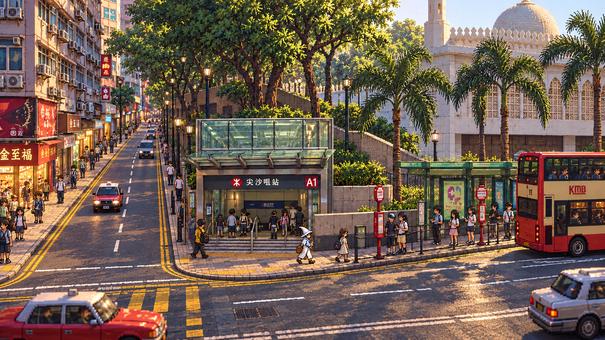
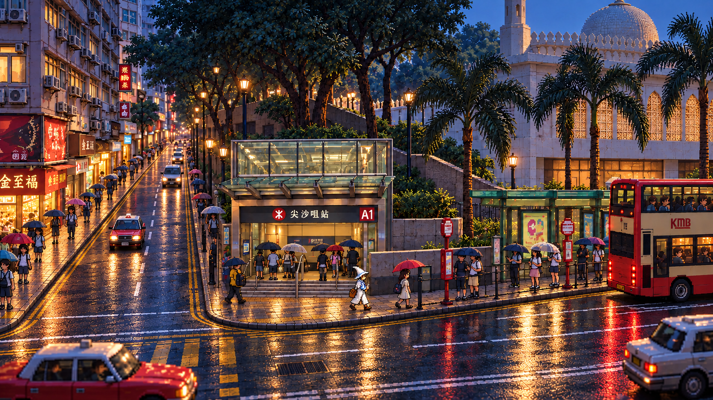
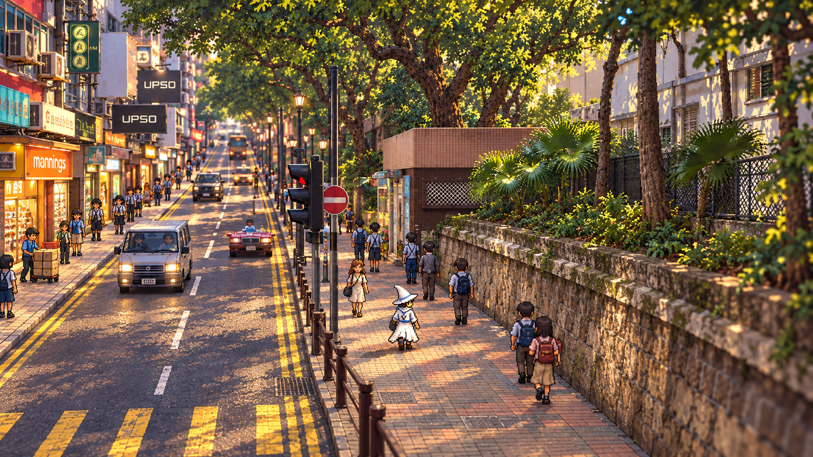
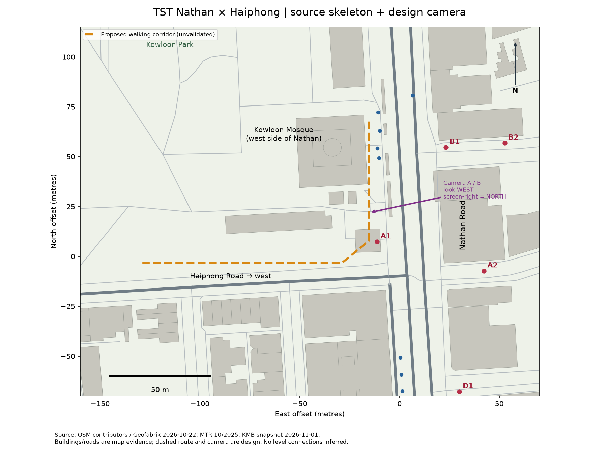

# HD-2D 渲染参考与资产拆分

2026-11-01，使用内置 imagegen，实际输入 GIS 布局图与三张实景照片；夜景从修正版白天图编辑生成。完整 [提示词](../../../assets/blocks/tst-nathan-haiphong/generated/concepts/prompts.json) 和 [输入／输出哈希](../../../assets/blocks/tst-nathan-haiphong/generated/concepts/manifest.json) 随资产保存。以下均是概念，尚未获得用户美术验收，也不是 Unity 截图。

## A · 弥敦道主街白天

保留了主街横向、支路向西纵深、A1 北侧站口、清真寺及巴士站在更北侧的关系。第一版把海防道误画成铺砖步行巷，已定向修正为接入主街的沥青车行支路；未采用版仅留作迭代证据。

适合参考：玻璃入口与旧楼／白色清真寺的材质对比，雨篷和人物的前后遮挡、行道树、清楚的行走带。仍需修正：真实楼体比例与间距、部分臆造招牌和装饰灯、站牌压缩、路口标线及车道宽度；主角仍带蓝色细节和背包，帽形尚不符合最终简洁三角白帽目标。不能裁出这张主角作为最终精灵。

## B · 同机位雨后夜景

用同机位比较玻璃站口透光、冷暖光、湿地反射和雨伞轮廓。只是时间天气设计，不是实景夜间照明记录；实际制作应减少地面镜面反射和过密亮点，先保证白帽与可走区域清楚。不可凭此宣称已验证 URP 景深或反射性能。

## C · 进入海防道

从实际西望照片转译出南侧商铺、北侧挡墙／树冠、粉砖建筑、栏杆与连续人行道；手推车收货是显式设计活动。适合参考遮挡拆分与沿支路前进的镜头距离。

仍需修正：模型把纵深道路画得偏上坡，不能用作高程依据；车道／禁入牌与行车方向必须重新按真实数据核实；出租车与远处车辆细节存在生成畸形。NPC 服装过于集中为类似学生制服，需替换为年龄、衣着和目的不同的普通行人。主角造型同样待独立设计。该图更接近纵深特写，不能替代常态横向主街镜头。

## 地理与镜头引导

虚线是未验证的步行走廊，甚至需要绕开 A1 的具体体积才能实现；GIS 交叠不表示可通行。这张图控制道路和街侧，概念图不能反过来改它。输入照片出处见 [来源](sources.md)。

## 下一批生产分件

- 地面：沥青、人行道砖、路缘、渠盖、标线单独材质／贴花；先校正真实宽度。
- 建筑：A1 玻璃罩／钢梁／台阶／标识分拆；普通楼一套首层店面＋窗格／冷气机；清真寺只做当前机位可见的正确轮廓和拱窗模块。
- 深度遮挡：挡墙、树干、树冠、雨篷和栏杆独立，能测试局部隐藏及透明深度；不是把整图简单分层。
- 交通：巴士、车门、候车区、站牌与路线文字分别制作；车型与站位核对后再做循环。车门朝向和车身比例不能从生成图自动采信。
- 角色：单独确认简洁白帽小巫师轮廓、48—64 源像素起始试验、方向动画／脚底锚点；普通行人按用途组合，避免复制制服群。
- 文字：站名、出口号、街名、品牌和路线全部独立排字校对，替换生成伪字。

先完成 20—30 米实机美术小样，再扩街段。上述生产分件、Blender 模型、街区 Unity 导入、NPC 运行和主角试走尚未执行。

## 许可与制作记录

实景来源为 Qwer132477 的 CC BY 4.0 和 LN9267 的 CC BY-SA 4.0 照片，详见 [参考索引](../../../references/blocks/tst-nathan-haiphong/index.json)。本组概念作为这些照片的 HD-2D 转译，按 CC BY-SA 4.0 提供可许可的改编部分；保留作者／来源并注明 AI 转译和布局重组，不暗示作者认可。此标注不授予品牌或建筑额外权利，也不扩展为全仓库代码许可。
