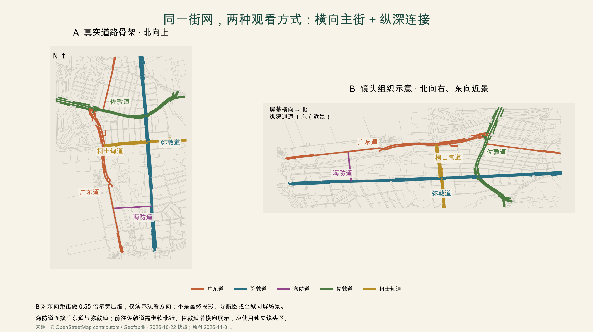
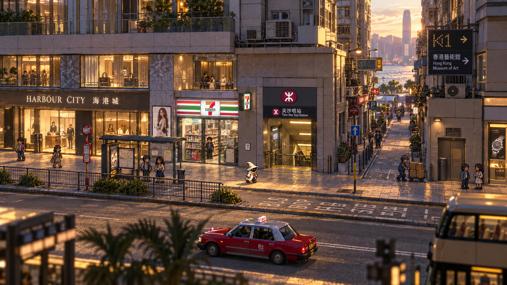

# HD-2D 香港：街网、镜头与制作管线

2026-11-01 · 策划 v0.4 专项 · 地图证据、设计假设与待验证工程分别记录。

## 1. 方向已经改变，范围仍按街段推进

**采用像素角色与像素纹理的立体环境，制作以横向主街、纵深连接和多层通行为核心的 HD-2D 步行世界。** 香港的沿街裙房、楼上招牌、雨篷、台阶、天桥和远处高楼，应在同一镜头中形成真实的遮挡与距离关系。像素角色是表现选择；环境、碰撞、灯光与相机从第一天就按 3D 组织。

《八方旅人 II》开发者介绍了 2D 像素人物与几乎全部由 3D 构成的背景，以及探索时固定镜头的选择。我们借鉴这种组织方式，具体配色、香港建筑模块和白帽角色仍自行设计。[开发者访谈](https://www.unrealengine.com/developer-interviews/octopath-traveler-ii-builds-a-bigger-bolder-world-in-its-stunning-hd-2d-style?lang=en-US)

这里的“立体”是可控镜头下的模块化街道布景：有体积的墙角、路面、楼梯、雨篷和桥面，搭配像素贴图与少量远景卡片。无需恢复旧项目全城高精度写实建模。没有剧情、战斗、可乘交通；港铁与巴士仍承担街道识别、出入人流和声景功能。

## 2. 真实街网怎样成为横向开放世界

上图用本项目实际 OSM 道路绘制。研究框内按名称选出广东道 51、弥敦道 76、海防道 4、佐敦道 74、柯士甸道 28 个要素；同一道路可以有机动车道、步道和分段对象，数量不是街道条数。右图只把北映射到屏幕右、东映射到近景，并对东向距离做示意压缩；不是最终游戏投影，也不表示两条主街应始终同时出现在镜头里。来源：© OpenStreetMap contributors / Geofabrik，2026-10-22 快照。[源 ID 与哈希](../../data/hong-kong/hd2d-study/corridor-evidence.json)

**地图核对结果：** 广东道和弥敦道在尖沙咀段主要为南北向，海防道在东西方向连接两者。海防道不直接连接佐敦道；一种合理的探索顺序是“广东道 → 海防道 → 弥敦道北行 → 佐敦道”。这只是街道拓扑顺序，尚未逐段确认人行侧、过街点、施工及开放时间，不能当作已验证的步行导航。

本轮实际打开了已有的港铁尖沙咀与佐敦街道图。图中北箭头朝页面左侧，不能把印刷页面的横纵方向当作地理北东。两份快照页脚分别为 10/2025 与 11/2024；地图来源与新生成图的日期分别记录。[港铁尖沙咀图](https://www.mtr.com.hk/archive/en/services/maps/tst.pdf)、[港铁佐敦图](https://www.mtr.com.hk/archive/ch/services/maps/jor.pdf)、[本地尖沙咀图](../../data/hong-kong/mtr/mtr-maps-tst.pdf)、[本地佐敦图](../../data/hong-kong/mtr/mtr-maps-jor.pdf)

九巴 W4 官方单张可辅助识别西九龙、西九文化区、广东道及尖沙咀交通节点，包含广东道新港中心／北京道等站位描述。其标示生效日为 2025-09-20；本轮将它作为有日期的线路与街区参考，不宣称班次今天仍有效，不用巴士线路推导步行可达性。[九巴 W4 官方单张](https://www.kmb.hk/storage/files/W4%20leaflet%20v1.pdf)

### 镜头区建议

| 镜头区 | 组织方式 | 保留的城市关系 |
| --- | --- | --- |
| 广东道沿街 | 相机主要从东看西，北大致映射屏幕右；展示西侧商业立面，东侧近景按遮挡规则处理 | 海港城临街界面、入口与道路南北顺序；店铺不能随意换街侧 |
| 海防道连接段 | 沿同一世界坐标走向镜头或远离镜头，适度调整跟随距离；主街转角保持可见 | 广东道与弥敦道的东西关系；不做地图传送门 |
| 弥敦道沿街 | 尽量沿用该片区的观看方向；用站口、路口与公园边界建立方向感 | 与广东道平行的另一条主轴；并非把所有重要商铺都摆到镜头背面 |
| 佐敦道 | 东西向街道若也要横向展示，进入单独编排的镜头区 | 通过路口锚点、短镜头过渡和地图北箭头解释方向变化 |
| 海滨／尖东／西九 | 根据海面与地标视线独立编排，连接处保留可识别的转角或门廊 | 海陆方向正确；中银大厦只在合理的对岸视线里出现 |

同一个固定相机无法同时把互相垂直的两条道路都变成横向。首选是“区内稳定镜头＋少数明确的镜头区转换”，不提供自由绕人物旋转的相机。若自动旋转造成迷向，退回路口短淡入淡出的定向切镜；这个取舍由试走决定。

横向是构图偏好，不限制玩家只能左右走。玩家可在人行道宽度内自由移动、绕过人群、穿过连接街、进入已开放的台阶与通道；不增加跳跃平台玩法。对面商铺即使处于近景，也保留真实位置，通过减低遮挡、局部立面剖开或特定观察区展示，而非移到另一侧。

### 山城感来自可靠高差

香港整体地形有山海变化，但不能因此把整个尖沙咀画成连续陡坡。这里先表达有证据的局部高差：公园边缘、台阶、架空平台、地下行人通道、天桥和建筑前场；未核实的具体坡度不从概念图反推。

CSDI 三维行人路径是带高程的路径网络，不是连续地形 DEM，也不直接给出建筑完整体量。每个高差保留来源、`level_id`、起终点和开放条件；没有证据的高度记录为待定。桥上桥下、地铁出入口和升降机不能因为二维图上相交而自动相连。首个真实街段没有天桥时，用独立的灰盒测试件验证桥下遮挡，不把虚构天桥永久插入广东道。

## 3. 新概念图与美术规范

本图由内置 imagegen 生成，用于比较低视角、连续立面、纵深支路、白帽角色和前景虚化。**海港城、港铁口与便利店的相邻关系是构图编排；坡度、标牌和海面视线未核实。背景材质偏平滑写实，尚未达到正式环境应有的像素纹理统一度。** 它不作为地图施工图、深度图或可直接使用的背景。[完整提示词](../../assets/concepts/hd2d/prompt.txt)、[文件哈希及限制](../../assets/concepts/hd2d/manifest.json)

旧四张概念图保留为角色、色彩与内容研究；旧戏曲中心图不再作为默认日常镜头。正式资产分别制作角色、楼体、路面、灯光和前景，不能把整幅生成图切几层就宣称具备正确透视与隐藏几何。

建议先比较以下参数，均为美术实验输入而非实机结论：

- 镜头：向下俯角约 25–35°，较远相机配合较窄视野的弱透视，与正交方案各做一版。最终角度以脚底可读、街道纵深及双侧铺面可见性决定；不能只凭单帧漂亮定案。
- 角色：以含帽 48–64 个源像素高为起点，测试四方向和八方向；屏幕尺寸由相机与角色世界高度共同决定。镜头转向时，动画方向按“相对相机的运动方向”选择。
- 环境：模块化低面数体积＋有明确像素颗粒的贴图；重点街面与角色统一视觉密度。材质导入先比较 point 采样与远景 mip 策略，检查斜面闪烁，不能以全局禁用 mip 作为万能规则。
- 分辨率：以 1080p 输出做首轮比较，并检查 720p／1440p 和窗口缩放。取消全屏固定 640×360＋整数放大的硬约束；像素贴图不要求整个三维画面都变为同样低分辨率，UI 单独保持清楚。
- 标识：繁体中文、英文、路线号、出口号独立排版。关键文字可以比背景纹理更高分辨率；像素风不应让站名、店名成为伪字。真实招牌是核实后的资产，不复制生成图乱码。
- 楼体：首层立面、转角、屋檐与雨篷有体积；上部楼层按轮廓压缩或在画外延伸。背街与高层远景可以简化，但镜头会看到的侧面必须存在。

## 4. 渲染与通行的具体方案

**主选验证栈：Unity 6 + URP Universal Renderer（3D 路径）＋受光像素角色平面＋3D 街道几何与碰撞＋Cinemachine 镜头区。** 不以 URP 2D Renderer、全局 Y-sort 或 2D 物理为基线。完整版候选比较见 [引擎复评](引擎调研.md)。

### 深度、遮挡与图层

人物逻辑根节点负责 3D 移动、碰撞与足底位置；视觉子节点是直立的角色平面，只绕竖轴朝向镜头，避免连脚底一起倾斜悬空。先验证 alpha clipping 的受光材质及正确深度／投影通道；透明玻璃、粒子与半透明淡出单独测试，不假设它们和不透明几何拥有完全相同的景深行为。[URP Lit 材质](https://docs.unity3d.com/6000.0/Documentation/Manual/urp/lit-shader.html)

真实几何深度处理正常前后遮挡；近景屋檐、树冠和立面设置可选择的遮挡区域，仅在妨碍玩家阅读时淡出或抖动裁切。墙体背后的主角不应永久透墙显示。雨棚、屋顶、招牌、灯具与楼体分件，有自己的碰撞／阴影策略；活动楼层与渲染层并不是同一个字段。

角色投影须额外检验：面片旋转时不能让阴影剧烈跳动；必要时用独立简化投影代理或稳定接触阴影。模型／贴图法线是否值得制作，以夜间侧光样板决定；不是给每个路牌强制做全套 PBR。

### 光照与景深

路灯和橱窗的实际灯光负责照亮路面、白帽和人物；发光贴图负责招牌自身亮度，bloom 只提供光晕，三者分别调试。静态环境可比较烘焙光照／光照探针与有限动态灯；记录日夜切换时的兼容方式，避免仅改变太阳却保留明显错误的静态夜景阴影。不把光追、实时全局光照或体积雾列为 HD-2D 成立的先决条件。

URP 的相机景深使用真实距离作为基础。焦点追随主角附近的可走平面并平滑变化，近处行走区域、主要招牌和 UI 保持可辨；远景适当模糊，树叶／雨篷可做较明显前景虚化。透明边缘光晕、帽尖裁切、焦点抖动必须分别检查，提供关闭景深选项。[URP 景深](https://docs.unity.com/en-us/engine/6000.0/manual/post-processing-and-full-screen-effects/urp/effect-list/depth-of-field-urp)

### 坐标与移动

地理空间继续保留原坐标；游戏布局另存：`game_x = east`、`game_z = north`、`game_y = elevation`，初始采用 1 Unity 单位对应 1 个设计米。HKPD 高程先扣除明确记录的本地高程基准，再映射；若艺术压缩发生，写独立转换记录，不改源数据。右侧示意图的 0.55 压缩不作为默认世界缩放。

输入根据相机的地面投影变换为世界移动；镜头过渡期间需锁定或平滑插值输入基底，避免按住右键时突然折返。转场触发器有进入／退出余量，防止在边界反复切镜。楼梯和坡面使用 3D 控制器的坡度／台阶参数；人行导航使用分层可行走面及明确跨层连接，避免 NPC 穿楼或把桥上桥下当同一路面。

Cinemachine 提供镜头间自定义过渡，但街段触发、输入连续性、遮挡与聚焦属于本项目适配责任；还需确认框架所用 Cinemachine 主版本。[官方镜头过渡](https://docs.unity3d.com/Packages/com.unity.cinemachine@3.1/manual/CinemachineBlending.html)

## 5. 街道生活在纵深里发生

原有 15 类资产族、16 类活动和街区差异继续生效。HD-2D 应让活动拥有可观察的空间过程：工人从近景货车搬箱跨到远处服务门；站口人流从下层出现后加入过街队列；巴士驶过时暂时遮挡行人，再露出变化后的候车队。休息日聚会、树下休息和雪糕售卖占用适当的停留空间，不能堵死主通路。

活动使用世界坐标、楼层、角色与道具绑定、开始／结束状态及声源位置。卸货声随距离和建筑遮挡衰减；远处人群用低成本表现，近处保留完整行为。玩家即使不移动，也能观察生活节奏；景深不能把所有生活活动都糊成背景。

地标和所有日常元素不同时挤进一个样板。先以真实街段中可核实的一组活动验证生产方法，再按区域扩大。详见 [香港街道生活设计](香港街道生活与沉浸感设计.md)。

## 6. 锁定方案前必须通过的小样

首个样板改为广东道—海防道交界附近的一个可核实街角：约 80–150 米主街界面＋约 30–60 米纵深连接作为选段范围，最终边界随人行连通性确定。无需一开始做完整海防道或把 Apple、站口、雪糕车强行放在一起。另设不计入真实地图的阶梯／天桥测试件。

| 验证项 | 通过条件 | 失败时如何处理 |
| --- | --- | --- |
| 空间与镜头 | 横向步行、深入支路、返回主街均能判断方向；双侧商铺有合理呈现；镜头区切换不反转输入 | 调角度／视距／切镜位置，再决定弱透视或正交 |
| 像素与深度 | 角色有清楚脚底、受光与稳定阴影；帽尖和树叶无明显深度毛边；移动纹理不持续闪烁 | 简化材质与后处理；先解决图像稳定再加细节 |
| 垂直通行 | 楼梯、坡面、桥下、桥上与停留层正确；读档恢复到同一层 | 修控制器、连接与碰撞，不靠渲染排序掩盖问题 |
| 框架省工 | 移动、暂停、镜头接入、场景切换可复用；新增代码集中在像素表现和街道逻辑 | 若需要重写控制器核心，重新评估框架与 Unreal 候选 |
| Agent 闭环 | 修改场景／材质／参数后可编译、运行、取得日志截图并导出 Mac Player | 记录缺失接口和人工步骤，不以 MCP 握手成功算完成 |
| 生活与性能 | 至少一组完整微活动；固定路线、固定分辨率与可见 NPC 数下测试白天／夜晚／景深开关 | 先限制阴影灯、透明层和远处更新；不直接扩大地图 |

P1 不要求全城流式、完整商店室内或全城实时交通。只有这一街角达到主观美术要求、操作舒适和独立 Player 性能目标，才锁定角色像素尺寸、镜头参数、材质与模块规格。当前完成的是研究、地图对照与概念图，尚未建立游戏工程、购买框架或测得性能。
