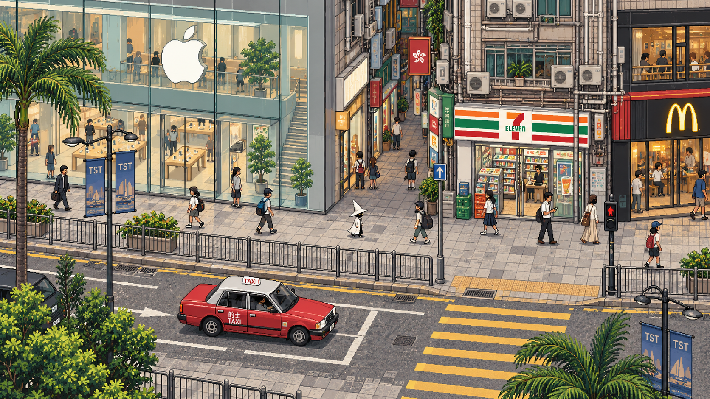
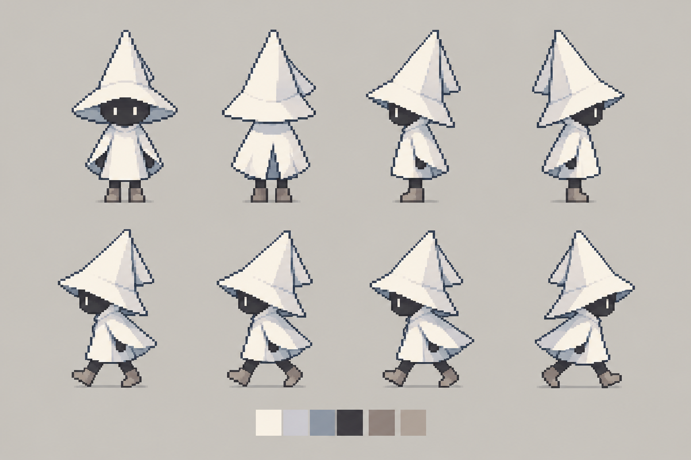
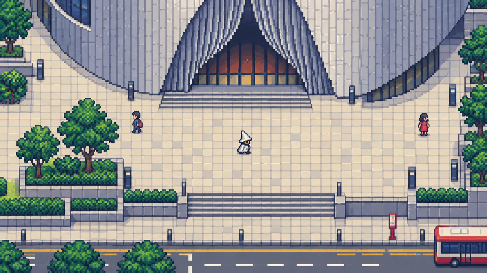

# 白帽漫游：像素九龙

2026-11-01 · 创意与技术策划 v0.4 · 暂定名 · 当前交付为研究、数据与概念图，尚无可玩版本

**采用以《八方旅人》为参照的 HD-2D：像素角色与像素纹理立体街景，横向主街、纵深连接及真实高差共同构成香港漫游。优先验证 Unity 6 + URP 的 3D 渲染路径与成熟框架的 3D 控制器；Unreal 为主要备选。**

v0.4 根据新的画面目标重写镜头、空间、资产与技术基线，替代纯 2D TopDown、固定 640×360 和“未来再添加真实深度”的假设。保留 v0.3 的街道生活目标、地图证据和逐街段扩展方式。专项图解见 [HD-2D 空间与技术方案](research/HD-2D空间与技术方案.md)，选型依据见 [引擎复评](research/引擎调研.md)，内容验收见 [街道生活设计](research/香港街道生活与沉浸感设计.md)。

本轮与旧 `game-research` 的关系是资料复用：继承地理、行人连接、站点和街道辨识元素；重新制定镜头、美术与生产方式。旧项目的双岸 3D、完整乘车系统、南港岛线及《异环》精度目标不进入本轮范围。可用数据已实际提取到本项目，旧仓库未修改。

## 1. 玩家要得到什么

一名戴三角白帽、穿白衣的小巫师，走在熟悉又略带童话感的香港街道上。玻璃橱窗、便利店条纹、黄色过路条纹、港铁入口、密集楼上招牌与维港共同构成体验。角色的安静与城市的繁忙形成视觉趣味，不需要给他安排身世。

- **首版玩法**：自由步行、快走、转向、碰撞、镜头跟随、暂停、位置保存；可选一张方位地图。
- **城市生活是核心内容**：站口进出、等灯过街、候车、卸货收货、排队取餐、休息日聚会、雪糕售卖等形成有始有终的活动。按街段逐步实现，不以无目的循环行人代替；无需依赖剧情任务，也不要求全城每个 NPC 常驻模拟。
- **沉浸感**：普通建筑与街道家具、人群关系、劳动过程、天气反应和有空间位置的声音，与地标同等进入制作验收。香港感来自正确组合和生活节奏。
- **探索动机**：前方转角、开阔海面、不同铺面与地标轮廓；不放任务箭头、战斗、经验、经济或饥饿系统。
- **观景**：海滨的固定位置可切换一幅远眺港岛的像素景观，再回到原位置。建议作为后续小功能；普通行走采用区内稳定镜头，转入不同方向主街时允许少数预先编排的镜头区转换。
- **首版不进入商店和地铁站内部**：有可辨识的门口、橱窗与站口即可。需要连通的地下行人段，在其所属街区制作时独立处理。

“开放世界”在这里指已开放街区可以自由往返、没有关卡结算，不要求一次建成全部街道，也不把全地图无缝加载当作硬要求；可先评估街区间短淡入淡出。对外不把背景天际线、暂未开放区域或不可进入建筑称为可探索内容。

## 2. 地理范围与地标清单

研究窗口为经度 114.150–114.186、纬度 22.289–22.328，覆盖西九龙—尖沙咀—尖东—佐敦—油麻地—旺角及缓冲范围。它是数据筛选矩形，含海水与边缘地块，不是行政边界，也不是首版精做面积。

| 地区 / 元素 | 在游戏里的作用 | 制作顺序与约束 |
| --- | --- | --- |
| 广东道、Apple Canton Road | 现代玻璃店面与街道识别锚点 | 首个样板候选；Apple 官网地址为广东道 100 号；具体临街范围再核对 |
| 海港城、中港城 | 连续商业裙房、入口与转角 | 核心区分段制作；两者是不同综合体，不合并 |
| 西九龙高铁站、戏曲中心 | 城市入口、曲线地标与开放广场 | 核心区第二条走廊；高铁站不是港铁九龙站，也不是柯士甸站 |
| 尖沙咀、尖东 | 商业街与海滨的连接 | 保留街道方位和主要连通关系；车站节点与街区概念分开 |
| K11 MUSEA | 海滨商业地标 | 主选海旁的 MUSEA；K11 Art Mall 是另一个位置，数据中单独保留 |
| 维港、中银大厦 | 远景和方位参照 | 中银大厦位于港岛中环，只作为对岸天际线，不搬到尖沙咀 |
| 佐敦、油麻地、旺角 | 北向扩展的生活商业街 | 分阶段接入；油麻地作为真实中间走廊，避免佐敦突然接到旺角 |
| 7-Eleven、麦当劳 | 日常尺度、铺面色块、夜间橱窗 | 使用真实品牌；按具体街段核对分店位置，不按概念图相邻关系施工 |

位置核对：[Apple 广东道](https://www.apple.com/hk/retail/cantonroad/)、[K11 MUSEA 官网](https://www.k11musea.com/en)、[中银大厦官方介绍](https://www.bochk.com/m/en/aboutus/corpprofile/boctower.html)、[戏曲中心通达指南](https://webmedia.westkowloon.hk/documents/Xiqu-Centre-Access-Guide-20260209-EN-tagged.pdf)。这些资料确认地标身份或地址，不足以确认每一间邻铺的现状。

建议的扩展顺序：广东道店面样板 → 广东道南段与海港城边缘 → 天星码头 / 海滨 → K11 MUSEA / 尖东；样板形成稳定生产方法后，再向中港城—戏曲中心—西九龙连接，最后由佐敦经油麻地北上旺角。具体连线必须落到真实可走路径，不把规划顺序当作已经验证的路线。

### 2.1 从原有地标扩展到街区锚点

重新整理旧地图后新增 35 个锚点组，其中 32 组有快照名称匹配；不是只覆盖用户最初举例的商场和品牌。名称匹配与真实入口仍要人工核对，证据见 [候选源 ID 清单](../data/hong-kong/street-life/landmark-evidence.json)。

| 街区 | 新增识别锚点 | 应同时还原的街道生活 |
| --- | --- | --- |
| 海滨与尖沙咀南 | 钟楼、天星码头、文化中心、太空馆、艺术馆、半岛酒店、1881 Heritage | 到站人流、酒店落客、摄影停留、海风船声、富豪雪糕车候选活动 |
| 弥敦道与公园边 | 重慶大厦、美丽都大厦、九龙公园、九龙清真寺、文物探知馆、圣安德烈堂、前九龙英童学校候选 | 港铁进出、楼上铺入口、拖行李旅客、会合与树下停留 |
| 尖沙咀内街/尖东 | The ONE、美丽华、讯号塔、科学馆、历史博物馆、尖沙咀中心、帝国中心、百周年纪念花园候选 | 餐饮等位、外卖取餐、店铺后勤、办公室午间与休闲人流 |
| 佐敦—油麻地 | 庙街、天后庙候选、玉器市场、果栏、戏院、红砖屋及生活街铺 | 住宅进出、开收铺、市场装卸、推车、清洁与夜间营业差异 |
| 旺角 | 朗豪坊、女人街、金鱼街、花墟及波鞋街候选 | 不同商品陈列、看货/交易、搬运、收放摊与群体出行 |
| 西九 | M+、香港故宫、ICC/圆方外围与绿地 | 观展、散场、休闲、跑步；保留开放空间，不复制旧街密度 |

这些是扩展制作目录，不把所有地标强行压到首版。前九龙英童学校、百周年纪念花园、油麻地天后庙在本轮名称匹配未命中，需继续定位，不能由“无匹配”推断不存在。具体来源和区域限制见 [街道生活设计](research/香港街道生活与沉浸感设计.md)。

### 2.2 普通设施与活动也要有清单

港铁口需区分标志柱、出口编号、楼梯/扶梯与升降机；巴士站需有营办者对应的站柱、路线板、排队与停靠位置。过街提示音、栏杆开口、路缘坡道、双语路牌、井盖与排水口构成连续道路界面。建筑还需有楼上铺目录、住宅入口、卷闸、雨篷、冷气设备、服务门和后巷。

富豪雪糕按流动售卖活动处理；休息日朋友聚会按群体活动处理；卸货按“停车—搬运—收货—撤离”的过程处理。它们各有时段、可用空间和结束状态，不是永久固定的静态摆件。少量完整活动优于大量互不关联的动作。

## 3. 世界空间：横向主街与纵深连接

源数据保持真实坐标，游戏布局另存；保留主要路口顺序、海陆方向、地标街侧、车站身份和跨层关系。**横向描述的是镜头中的呈现，不是将真实道路改成东西向，也不限制玩家只能左右走。**

实际地图中，广东道与弥敦道在尖沙咀段主要为南北向，海防道在东西方向连接两者。可将北映射到屏幕右侧，以海防道提供纵深探索。前往佐敦道的一种街道顺序是广东道 → 海防道 → 弥敦道北行 → 佐敦道；海防道并不直接到佐敦道。若要让东西向佐敦道也横向呈现，应进入单独镜头区，不能要求同一固定镜头把垂直道路都表现为横向。

本轮已对照 OSM 与已有港铁尖沙咀／佐敦街道图，并参考九巴 W4 官方单张的交通节点；街道顺序不等于已核实逐段步行导航。数据版本、来源及真实道路／镜头组织对照见 [空间方案第 2 节](research/HD-2D空间与技术方案.md)。

首个样板改为广东道—海防道附近可核实的街角，候选范围为 80–150 米主街界面＋30–60 米纵深连接，最终范围由通行与资料决定。初始按 1 引擎单位对应 1 个设计米，步行速度比较 1.5／2.2／3.0 设计米每秒；它们是舒适度实验参数，不是已确定物理尺度或工期。样板以能往返、进入支路和停留观察为准，不把全部地标同时塞入。

世界轴暂定 `X=东、Z=北、Y=高度`，镜头方向独立配置。地面距离压缩、高层美术压缩和相机投影分别记录，不用像素坐标承担世界距离。扩区连接过长时再比较保留长度与局部压缩，保存 `source_length_m / game_length_m / reason`；不改源 GIS，不丢分支和路口顺序。

香港的山海和立体通行值得表现，但不能把尖沙咀全区改造成陡坡。依据资料制作局部坡面、台阶、架空平台、天桥与地下通道；CSDI 的 Z 是路径高程，不是连续地形。未核实高度、跨层连接和开放时间必须保留为缺口。首街角没有天桥时，用独立灰盒测试件验证桥上桥下，不将虚构桥插入真实地图。

## 4. 美术规范与镜头

日常画面采用像素人物、像素纹理的简化立体建筑、真实景深与受控光照。区内镜头稳定、适度跟随，路口和特定方向街段可做有锚点的短过渡；首版不提供自由绕人物旋转。道路保留实际斜角，环境由模块化立体结构搭建，取消瓦片必须把所有道路规整成直角的压力。

以下是待样板比较的起点：

- 镜头向下俯角约 25–35°，弱透视与正交各比较一版；先保证白帽、脚底、纵深路径与双侧铺面可读，再确定视距和角度。
- 人物含帽约 48–64 个源像素高，四／八方向动画比较；角色视觉子节点与 3D 运动根节点分开。角色直立，方向动画按相机相对朝向选择。
- 以 1080p 输出比较效果，并检查 720p、1440p 与窗口尺寸；像素素材分辨率、三维渲染分辨率与 UI 分辨率独立。旧 640×360／16×16 规格不再约束全画面。
- 楼体提供转角、侧面、雨篷和真实深度；高层按轮廓压缩或裁出镜头。店铺立面、屋顶、橱窗、招牌、灯具可分拆，支持近景遮挡处理。
- 像素贴图先用 point 采样做基线，并验证远处 mip／抗锯齿的视觉取舍；不把所有材质禁用 mip 当成万能规则。镜头移动时纹理稳定性与单帧观感同等验收。
- 地面、米灰墙体、蓝绿玻璃和深绿树叶作为主色，商业与交通标识负责强调；不靠全城霓虹营造香港。白帽受暖光／冷光变化，但保持清晰轮廓。
- 繁体中文、英文、出口编号和路线板单独排字；关键文字优先可辨认。生成图中的伪字和店铺邻接关系不能直接沿用。
- 真实深度负责正常遮挡，近景树冠／屋檐按局部区域淡出；楼层与碰撞采用 3D 关系。景深焦点在主角附近稳定跟随，UI 和主要可走区保持清楚，提供关闭选项。

完整材质、输入与分层规范见 [HD-2D 空间与技术方案](research/HD-2D空间与技术方案.md)。本阶段参数均未通过实机或主观美术验收。

## 5. 概念图如何使用：新方向与历史研究

新的 HD-2D 构图与灯光研究已加入 [专项方案第 3 节](research/HD-2D空间与技术方案.md)。以下旧四图保留为色彩、内容和角色探索，不再以其俯视镜头作为默认空间规范。

### A. 广东道商业街：店面与生活密度

保留玻璃旗舰店、窄铺、树木、栏杆、的士和小巫师之间的比例关系。**这是一幅组合街景，Apple、7-Eleven、麦当劳的相邻关系未经核实。** 图中细节密度与透视尚未按新 HD-2D 规格统一；用作颜色、气氛与店面表达参考，不用作整张游戏背景。

### B. 维港观景：对岸与停留

作为特殊观景画面的情绪目标。中银大厦在水面另一侧，画面提供远近层次。楼群的精确顺序、太阳方位和比例尚未按实景视线校正；不能从这张图反推地图。日常 HD-2D 镜头是否能见到此地平线，仍取决于实际位置、遮挡和俯角。

### C. 白帽小巫师：轮廓与动作

保留你指定的艾达式安静感、三角白帽、白衣轮廓，并采用短披肩与深色小面部。图中四向和走路是造型研究；角色比例、足底锚点、帧间体积、轮廓一致性和透明背景仍需重新制作，不能直接裁切成合格动画。

### D. 戏曲中心：旧版俯视镜头研究

这是旧版俯视方案的空间密度研究：建筑上部裁切、地面清楚、主角小而可辨。曲面立面、台阶和前场均为概念化处理，需用实际开放空间资料复核；仍不是严格 16×16 网格或实机截图。新方案只继承其中的街道可读性与店面识别度；镜头由新的 HD-2D 样板决定。

上述四图均由内置 imagegen 生成；最终提示词和文件清单保存在 `assets/concepts/prompts.json` 与 `assets/concepts/manifest.json`。原图没有被缩图或脚本重绘来冒充像素资产。风格是否符合预期仍需你的主观选择。

## 6. 已提取的资料与边界

本次选区提取统计（2026-11-01 执行，源快照主要来自 2026-10-23 入库）：

| 资料 | 本项目数量 | 实际用途 |
| --- | --- | --- |
| OSM 道路要素 | 12,497 | 街道骨架；其中 5,979 个 footway、563 个 steps，不能全当机动车道 |
| OSM 建筑面 | 6,729 | 街区密度、脚印与地标候选，不等于 6,729 个待精做建筑 |
| OSM 点 POI / 面 POI | 3,085 / 986 | 商业与生活细节候选，营业状态未核实 |
| OSM 交通点 / 交通面 / 铁路段 | 949 / 25 / 262 | 交通位置、铁路走向参考，不是已实现交通系统 |
| OSM 用地 / 水面 | 1,636 / 26 | 开放空间与局部水面辅助；未形成完整海岸线底图 |
| CSDI 三维行人路径 | 34,282 | 保留 Z、楼层、方向和开放时间引用 |
| 行人网关联记录 | 1,924 | 楼层、建筑、场地、站点及访问时段；7 表中距离柱表在选区为空 |
| 运输署巴士 / 小巴 / 渡轮站点 | 320 / 334 / 4 | 站柱、码头、候车位置参考 |
| 港铁街道图与站内图 | 8 站 × 2 = 16 PDF | 尖沙咀、尖东、柯士甸、九龙、佐敦、油麻地、旺角、旺角东 |

运输署与这些站点关联的巴士路线记录为 499 条、小巴 84 条、渡轮 7 条；这里的“记录”不等于独立对外线路编号，也不代表首版提供这些线路。保留了区内站序行，区外站序未复制；不要把它当作完整行程或按两站直线驱动车辆。

道路、建筑按相交窗口筛选，保留整条源几何，所以个别对象跨出窗口；行人网使用转换后的保守米制矩形。OSM 内部 CRS 编号 100000 实际是 CRS84，经度在前，不是 EPSG:100000。行人网保持 EPSG:2326 的米制 XY 与 HKPD 高程，不能把 Z 当 WGS84 椭球高。

**已验证的范围**：解析与哈希、筛选计数、源坐标保留、运输署选区引用关系。读取 FGDB 时出现空间索引深度警告，因此额外对全量 465,892 条路径做了无空间索引的几何扫描；与选区 34,282 条 ID 完全一致。尚未验证游戏路由、碰撞、商店位置现状或实机性能。

补充资料 `street-life/` 从原始 PBF 新提取 3,257 个街道节点，其中 144 个轨道入口候选、1,447 个过街点、789 个信号节点、133 个电梯节点。数量代表快照要素，不是独立设施普查；节点与原 POI 可能重复。另保存 35 组新增锚点证据和 69 项工程/环境资料索引。人群、雪糕车日程、卸货时段与录音不在这些数据里。

“管网”若指供水、排污、电力等地下设施，本次资料中未确认可用覆盖；已有的是道路、行人和公共交通网络。纯步行首版不依赖地下管线。另有西九龙高铁站专属布局、海岸线、逐店立面照片、声景和部分通行条件待补齐。

数据说明与复现命令见 [提取包说明](../data/hong-kong/README.md)，转换与哈希见 [manifest](../data/hong-kong/manifest.json)。上游 48 项城市记忆表只作为历史候选参考，里面旧项目的 P0/P1 不自动成为本项目需求。

## 7. 引擎选择

**主选验证：Unity 6 + URP Universal Renderer（3D）＋TopDown Engine 的 3D 模式候选＋兼容版本的 Cinemachine。Unreal 为主要备选，Godot 3D 为开源备选。** 这次从“2D 先行、以后补深度”改为从第一天使用三维空间。框架尚未购买、安装或证明兼容，正式版本待小样验证后锁定。

Unity 推荐的依据是必要通用组件复用、C#／编辑器自动化和受控街段制作的平衡。框架官方具有 3D 控制器及逻辑／视觉分离入口，但相机、坡面、像素受光与深度仍需验证。[TopDown Engine 角色文档](https://topdown-engine-docs.moremountains.com/character-classes.html)

Unreal 有《八方旅人》的制作先例，当前官方还提供实验性 MCP，因此不能按缺少 Agent 支持排除。若 Unity 框架的适配大量侵入核心，或样板画面难以稳定达到要求，应以同一街角评估 UE，而非继续盲目追加插件。[Unreal MCP 官方文档](https://dev.epicgames.com/documentation/unreal-engine/unreal-mcp-in-unreal-editor)

Godot 3D 的 Sprite3D、受光、相机和文本场景能支持这一方向；其代价主要是通用系统的组合工作。GameMaker 的官方 CLI/MCP 不能忽略，RPG Maker MZ 也有 JS/JSON 与第三方自动化；本次降低两者优先级，是其默认流程与立体街道、跨层通行及深度材质的整合成本，不是简单认为它们陈旧。

本机现有 Unity 版本为 `6000.6.7f1`；它不是已安装的 6.3 LTS。没有在本轮升级编辑器、安装 MCP、购买框架或创建游戏工程。完整五引擎比较、官方／社区／实验性边界和版本策略见 [引擎复评](research/引擎调研.md)。

## 8. 最小技术结构

离线加工链：`真实 GIS → 选段与证据核对 → 独立游戏布局 → 模块化 3D 场景＋像素资产 → 引擎场景`。运行时只读加工后的资源，不联网查询 GIS，不依赖旧仓库，也不加载全港 GPKG。

先复用框架与引擎已有组件，再写香港街道需要的适配：

- 运动与输入：采用一个 3D 控制器，移动根节点与像素视觉子节点分开；验证坡面、台阶及相机相对输入，避免并行控制器争抢位置。
- 镜头：Cinemachine 或框架兼容的相机负责跟随与过渡；项目配置街段镜头区、切换余量、焦点和遮挡处理，转场期间输入不能突然反向。
- 区域：首街角常驻；相邻街段先允许短淡入淡出，是否预载／流式由实测决定。按沿街场景和连接口分区，不以旧 64×64 瓦片强制分块。
- 资产：路面、体积立面、雨棚／屋顶、橱窗与灯具分件；角色以 alpha-clipped 受光平面为起点，检查深度、阴影和半透明边缘。
- 楼层与导航：3D 碰撞、可行走面和明确跨层连接；桥上桥下独立，投影相交不建连接。人群路径必须遵守路口、队列和活动占用。
- 状态：复用可用的保存设施，项目定义区域、世界位置、朝向、楼层、活动时间、设置和版本；框架库存存档不是完整世界存档。
- 街道活动：把人物、车辆、道具、服务门、等候锚点与空间声源绑定成活动；近处完整模拟，远处简化，合理进出场。

保留 `source_id`（不可变来源）、`place_id`（现实地点）、`asset_id`（复用资产）、`instance_id`（本次放置）四种身份。世界资产字段候选为 `chunk_id、level_id、position_m_xyz、foot_anchor_local、collision_shape_3d、occlusion_group、camera_zone_id、source_ids、geographic_edit_note`。真实高程与游戏高度转换显式记录，玩法楼层、渲染深度、光照分组不能混用。

资源读取、实例化、碰撞创建和首次着色器使用需要分别测量。加法加载支持不等于已解决城市流式；首版不需要 ECS、服务端或全城人口常驻模拟。完整的深度／光照／景深及像素工作流见 [专项技术方案](research/HD-2D空间与技术方案.md)。

## 9. 资产生产：让第二个街段更便宜

旧版静态样板预算仅作内容量参考，需按新镜头重估：1 个地面图集、6 个普通立面模块、3 类品牌招牌 / 橱窗模块、12 类街道道具、1 名主角的四向动作研究、1 辆出租车和 1 辆巴士、4 种路人配色变体。这只是静态起步预算，不是终极内容上限；人群需要追加站立、坐下、等候、携物、推车等动作，不能靠四种配色替代行为差异。按首街段选定的活动增加站口/站牌、货车/手推车、箱筐和声音等成套资产，再实测制作成本。

普通资产包括交通设施、道路家具、大楼/商铺界面、后勤设备、停留设施、气候设备、保洁维护、市场货品、海滨和酒店界面等 15 个资产族。完整目录与 16 类活动见 [街道生活设计](research/香港街道生活与沉浸感设计.md)。模块复用同时保留街区和年代差异。

建筑生产资产拆为具有体积的底座、立面、转角、屋顶／雨篷，配独立像素贴图、招牌与发光遮罩；共享世界尺寸与基准点。法线与阴影代理按效果需要制作，真实几何承担基本深度。先验收一栋商铺的分层包，再批量生产。

生成式工具用于概念、色调和局部方案探索。进入生产需要像素编辑、统一调色板、模块建模与 UV、足底锚点、深度／阴影检查和遮挡分件。不要把整幅 AI 街景按屏幕平铺：这样会失去转角、碰撞、通行与邻接一致性。

生成输出与手工修订分别放 `generated/` 和 `authored/`；构建脚本只刷新 generated。已精修图块通过清单选择，重跑脚本不能覆盖 authored。这个约定直接针对旧项目程序化生成覆盖手工精修的风险。

首街段通过后，用同一套素材做第二条相邻街段。若主要时间仍用于逐栋重画、几乎没有模块复用，就暂停扩区，先修改资产颗粒度与镜头。此时新增更多自动化工具通常不能解决问题。

## 10. 实施阶段与验收

以下是工作量估算，用于约束范围，不是 Agent 完成时长承诺；没有以当前素材做过生产测速。按一名熟悉引擎的制作人员、有像素美术修订参与估计，实际耗时主要取决于美术接受与街段资料质量。

| 阶段 | 内容 | 工作量初估 | 通过条件 |
| --- | --- | --- | --- |
| P0 本轮 | 源数据提取、概念图、引擎调研、策划案 | 已完成本轮文档交付 | 数据可复现；概念图明确标注边界 |
| P1 框架与渲染验证 | 横向街角＋纵深支路＋高差测试件、3D 框架接入、Agent 闭环、日夜与真实景深 | 框架/渲染组合实测后估算 | 移动稳定、组件可复用、Agent 可运行诊断；分层灯光与遮挡成立 |
| P2 首个生活街段 | 真实商铺/设施关系、统一像素资产、至少一组完整微活动与停留行为 | 待 P1 活动样板实测后重估 | 可走可停，能观察活动始末；空间、声音和动作一致 |
| P3 相邻街段 | 第二段、模块复用、镜头区／区域切换与保存 | 待 HD-2D 样板测速后重估 | 可往返、读档正确；淡入淡出可接受，复用降低新增制作量 |
| P4 尖沙咀核心 | 向海港城 / 海滨 / K11 与西九龙方向分批扩展 | 在 P3 后按街段实测重估 | 每批 2–3 街段验收后再扩大，不提前承诺整片九龙工期 |
| P5 北向扩展 | 佐敦—油麻地—旺角 | 未估算 | 核心区的稳定性、密度和美术标准已成立 |

建议首个里程碑仍是 P1–P3；此前纯 2D 的相邻街段 3–6 人日估计也不沿用。此前 **8–17 人日** 的总估算随框架/渲染验证范围变化而撤回，完成 P1 后重估，不承诺一次完成整个开放世界。若连续两次美术复核仍不能接受同一镜头，先修改镜头或像素密度，不继续添地标。

验收场景应固定并可重复：

1. 从店门走到街角，再走回；墙角、栏杆、树池不穿透、不粘住。
2. 主角走到建筑前、后及天桥下；脚底方向、真实深度、楼层与阴影始终清楚；另测楼梯及坡面。
3. 来回穿过镜头区与街段边界 20 次，停留后保存并读档；没有漏块、重复道具、镜头反复切换、输入突然反向或存档出现在错误楼层。
4. 在 720p、1080p、1440p 与非整数窗口尺寸检查像素边缘、文字和镜头抖动。
5. 在用户 Mac 导出的独立 Player 运行至少 10 分钟；帧率目标 60 fps，暖机后帧时 P95 ≤16.7 ms、P99 ≤25 ms，常态移动不出现 >50 ms 的明显停顿；若采用淡入淡出转场，另记录完整转场耗时。它们是目标，不是本轮已测结果。
6. 比较第 2–5 分钟与第 7–10 分钟相同路线的内存；目标为进入稳定平台，不能只看启动瞬间。记录引擎版本、渲染器、分辨率、可见角色数和区块数。
7. 美术盲测隐藏地名 UI，确认是否仍能辨识香港；由地形、铺面、交通、人群与声音改善，不靠额外文字解释。
8. 原地观察两分钟，至少看见一组完整微活动；卸货有去向，队列有变化，人物有合理进出，玩家不被堵住。
9. 比较工作日/休息日和晴/雨预设，活动与空间使用确实不同；熟悉香港的体验者指出不真实或缺失之处，并据此修正。

## 11. 下一步具体工作单

首选广东道—海防道附近的真实街角，先核对双侧沿街立面、人行过街与连接位置；确认参考年代和地标街侧，再做可往返的灰盒。比较弱透视／正交镜头、横向步行与纵深支路可读性；用独立高差测试件检查楼梯、桥上桥下和保存恢复，不为技术展示修改真实街网。

随后接入白帽像素人物、一栋分件商铺和一组有依据的街道活动，测试白天／夜晚／景深开关、角色受光与遮挡，并完成 Agent 改场景—编译—运行诊断—导出闭环。框架与渲染结果成立后，才锁定像素尺寸、模块规格和正式版本。

这一步验证：**街道层叠是否像香港、走入纵深是否自然、停下来是否有生活可看、组件与 Agent 工作流是否省工、第二条街是否能沿用生产方式。** 当前地图、五张探索图与文档为研究交付；尚未得到用户美术验收、可玩版本或性能结论。
